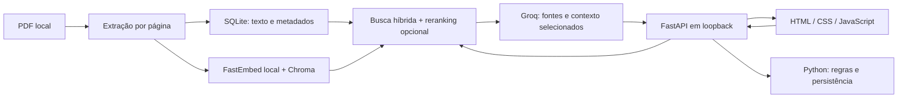

# Assistente de Ordem Paranormal · Livro, missões e fichas

[](https://github.com/vitorlimeira22/rpg-rag-assistente/actions/workflows/ci.yml)

Projeto de portfólio em Python para estudar extração de PDF, recuperação de informação, RAG, FastAPI e testes. O sistema escolhido para uso privado é **Ordem Paranormal RPG, edição 1.1**. O repositório inclui um pequeno livro fictício, criado para demonstração pública.

Projeto independente de estudo, sem afiliação oficial. **O livro, o formulário PDF, as chaves e os dados pessoais não acompanham o código.** A geração usa uma chave Groq fornecida por cada usuário; busca textual e conferência de páginas funcionam sem ela. O programa é local e não é um serviço público hospedado.

[Instalação reproduzível](#instalação-reproduzível-recomendada) · [Segurança](SECURITY.md) · [Publicação no GitHub](docs/PUBLICACAO.md) · [Licença AGPLv3](LICENSE)

Para estudar a arquitetura, leia a [pesquisa no livro com ferramentas](docs/PESQUISA_NO_LIVRO.md), a [revisão técnica da versão 0.2](docs/REVISAO_TECNICA_2026-10-20.md) e o [dossiê didático da versão inicial](docs/DOSSIE_TECNICO.md). O dossiê preserva o retrato de 16/10; os documentos posteriores registram a evolução.

## Versão 0.3 — uso atual

- **Consultar o livro:** busca híbrida, reranking local opcional, explicação e páginas verificáveis.
- **Conversar sobre o livro:** conversas salvas em SQLite, retomada após recarregar e fontes vinculadas a cada resposta. É possível escolher consulta ou criação de missão e uma campanha ao iniciar a conversa.
- **Comparar criaturas por VD:** extração das fichas e cálculo de máximos em Python, por elemento principal, preservando empates e informando a cobertura.
- **Criar missões:** modo criativo com instruções próprias e contexto de uma campanha selecionada. O prompt orienta a identificar invenções como sugestões e a citar fontes para afirmações de regras. O mestre precisa revisar o resultado.
- **Ficha com assistente próprio:** editor central e chat lateral ligados ao mesmo registro salvo, com atributos, perícias, habilidades, inventário, rituais e anotações. Python confere o recorte NEX 5/10/15 das três classes, alguns efeitos e pré-requisitos, patente e carga. Propostas inconsistentes recebem no máximo uma correção; se continuarem inválidas, não alteram a ficha. A conferência permanece parcial.
- **Exportar ficha editável:** usa o formulário PDF local configurado, preservando os campos editáveis e acrescentando um complemento para textos extensos e ressalvas. O modelo protegido não acompanha o repositório.
- **Organizar uma campanha:** resumo, regras da mesa e acontecimentos persistidos em SQLite. Somente o usuário registra acontecimentos; gerar uma missão não altera o histórico da campanha.
- **Interface responsiva:** navegação por tarefa, estados de carregamento/erro, fichas editáveis, fontes e avisos de limitações.

O aplicativo é pessoal e deve ser iniciado em `127.0.0.1`. Não tem autenticação para exposição pública.



### Identidade visual

A paleta foi inspirada no [site oficial de Ordem Paranormal](https://ordemparanormal.com.br/): fundo quase preto, superfícies grafite, detalhes em âmbar e texto claro. Os títulos usam fontes locais condensadas — Bahnschrift Condensed, Arial Narrow ou Bahnschrift, conforme disponibilidade —, o corpo usa Segoe UI e pequenos rótulos usam Consolas, todos com alternativas de sistema. Essa adaptação alterou somente cores e tipografia; não adicionou imagens, downloads de fontes ou serviços externos.

O visual anterior ao chat foi conferido em desktop de 1.366 px e celular de 390 px: [captura desktop](docs/images/interface-ordem-desktop.png) e [captura mobile](docs/images/interface-ordem-mobile.png). Na revisão do chat, as medidas do DOM não mostraram transbordamento horizontal nas larguras CSS de 387 e 1.688 px. A ferramenta de captura não produziu novas imagens nessa rodada; as capturas vinculadas são históricas.

### Evolução — consulta com ferramentas de pesquisa

No modo **Conversar**, o backend recupera fontes iniciais e monta um mapa de navegação a partir dos títulos e intervalos de páginas registrados no SQLite. As fontes ficam disponíveis desde a primeira rodada. O modelo pode responder diretamente ou pesquisar o que faltar; não há leitura automática de páginas de catálogo. Veja os resultados e as limitações na [revisão resumida](docs/PROXIMOS_PASSOS.md).

Com orçamento para pesquisar, as ferramentas usam `tool_choice="auto"`; o modelo escolhe se precisa delas. `search_book` devolve até três prévias de 400 caracteres próximas aos termos encontrados, preservando os limites de entradas de listas e sinalizando cortes. `read_book_pages` permite ler até duas páginas, com até 6 mil caracteres por página. Uma prévia não comprova o que foi omitido; o limite acumulado ainda pode impedir a leitura de continuações.

Quando o livro corresponde ao perfil de regras conferido de Ordem 1.1, a consulta também oferece `validate_basic_character`. A ferramenta usa Python para conferir os cinco atributos e calcular valores **base** na criação em NEX 5%, com a classe e os atributos informados pelo usuário. Não salva dados nem valida a ficha completa. Argumentos, resultados e referências aparecem separadamente em `rule_checks`, com fontes canônicas compactas; origem, perícias, poderes, rituais, equipamentos e evolução continuam fora dessa validação.

Os padrões permitem **uma a quatro chamadas ao modelo**, até **4 operações de ferramenta** e **16 mil caracteres de evidências únicas** por pergunta. Configurar `CONSULT_MAX_MODEL_CALLS=1` ou desabilitar `CONSULT_TOOLS_ENABLED` permite uma geração sem pesquisa adicional. O mapa contém até oito seções e 1.500 caracteres; seus títulos e intervalos orientam a busca sem receber números de citação. As páginas efetivamente lidas recebem referências. Citações numéricas alternativas como `【7】` e `【7†】` são normalizadas para `[7]` antes da conferência dos identificadores. Essas verificações não comprovam que a resposta está correta.

Perguntas reconhecidas como comparação de criaturas por maior VD usam `creature_catalog.py`: o Python varre as fichas do perfil Ordem 1.1, identifica o elemento principal, calcula máximos e empates e apresenta os resultados com fontes, **sem chamar a API**. A definição de VD também é extraída do livro. Isso resolve uma limitação do top-k: uma pequena amostra de busca não permite calcular o maior valor de um conjunto inteiro. Não são respostas ou nomes de criaturas fixados no código. Outros critérios, exclusões, top-N e continuações dependentes do histórico seguem a consulta geral; esses filtros não são silenciosamente ignorados.

### Histórico e privacidade

Cada conversa guarda mensagens completas e snapshots das fontes localmente. A geração recebe até **oito mensagens recentes, limitadas a 6.000 caracteres**, além da pergunta, das fontes e da campanha selecionada. O histórico ajuda a entender continuações; respostas anteriores não são evidência do livro. O restante continua visível na interface, mas não representa memória ilimitada para a LLM. A escolha de modo e campanha fica fixa por conversa.

Um identificador por envio impede que uma repetição por falha de conexão gere outra chamada paga. Falhas interrompidas ficam registradas, sem repetição automática. Conversas pertencem ao livro usado na criação; se ele for substituído, o histórico permanece, mas é necessário iniciar outra conversa. Excluir uma conversa remove seu conteúdo do banco ativo; cópias de segurança anteriores não são alteradas. Os contadores de uso são preservados.

O histórico recente, o pedido e o contexto escolhido são enviados ao **Groq**, junto das fontes. A chave fica no servidor e nunca deve ser digitada no chat.

As ferramentas consultam o livro ativo e executam a conferência parcial de ficha quando o perfil é reconhecido. Elas não executam comandos, navegam na internet, abrem arquivos arbitrários nem alteram fichas ou campanhas. **Missões** continua com um fluxo próprio de criação a partir das fontes e do contexto selecionado.

Veja fluxo, configurações, dados enviados, contabilização e limitações em [Pesquisa no livro](docs/PESQUISA_NO_LIVRO.md). A avaliação real dessa evolução é registrada separadamente dos testes automatizados no [relatório de pesquisa com ferramentas](evaluation/results-research-2026-10-20.md).

## Plano de desenvolvimento

1. **Importar e conferir o PDF:** extrair texto por página, registrar a página do arquivo, o número impresso e os marcadores de capítulo/seção. **Implementado.**
2. **Consultar com fontes:** combinar busca textual e vetorial, mostrar a página original e gerar uma resposta pela API de IA quando configurada. **Casos reais conferidos com Groq; falhas de interpretação e abstenção registradas na avaliação.**
3. **Ficha de personagem:** criação assistida e edição persistente; conferir as escolhas e o escopo da validação antes de usar na mesa.
4. **Campanha:** persistência de fatos e modo de missão implementados; avaliar coerência em campanhas maiores.

## Arquitetura atual

- **PyMuPDF** lê o PDF e preserva a origem de cada trecho. O índice e os dados ficam em um arquivo SQLite local, ignorado pelo Git.
- **Símbolos de dados:** `pdf_text.py` identifica a fonte `d20-Regular` do livro 1.1 e converte seus ícones antes de indexar: `3` seguido de um ícone vira `3d20`; dois ícones consecutivos viram `2d20`. A legenda foi conferida na página 19 do PDF (11 impressa). Letras comuns e notações já legíveis, como `2d4` e `1d12`, permanecem iguais. Fontes de símbolos desconhecidas precisam de um mapeamento próprio verificado.
- **FastEmbed** gera embeddings multilíngues localmente usando o modelo `sentence-transformers/paraphrase-multilingual-MiniLM-L12-v2` (ONNX). A preparação do índice baixa o modelo para `data/chroma/model-cache`; consultas usam somente o cache local, sem tentar downloads. Se ele estiver ausente, a busca textual permanece disponível com aviso.
- **LangChain + Chroma** persistem e consultam os vetores em `data/chroma`. O adaptador `LocalEmbeddings` implementa a interface `Embeddings` do LangChain e o `Chroma` é o armazenamento vetorial. Cada vetor leva o ID do trecho e a página; o SQLite continua como fonte canônica do texto.
- **SQLite FTS5** faz busca textual e preserva siglas como PE/PV. Resultados AND são complementados por OR. Até 30 candidatos por método são combinados por RRF; um cross-encoder pode reordenar os 10 primeiros. A seleção final mantém até cinco fontes e permite até dois trechos complementares por página. `MAX_VECTOR_DISTANCE` é opcional: distância não comprova suficiência da resposta.
- **Janelas de tokens:** cada chunk pode produzir vários vetores, respeitando o limite efetivo do encoder. A busca reúne essas janelas no chunk original para exibir o texto com referência. O índice v2 é construído em coleção nova e só é ativado quando termina com sucesso.
- **Cross-encoder FastEmbed/ONNX:** `BAAI/bge-reranker-v2-m3-int8` pontua conjuntamente pergunta e trecho, em CPU. Não usa uma API. Se estiver indisponível, a aplicação avisa e mantém o ranking híbrido.
- **FastAPI** fornece uma interface local e endpoints JSON. O botão “Conferir página original” renderiza a página do PDF, permitindo comparar o trecho extraído com a fonte.
- **Groq API (`openai/gpt-oss-120b`)** gera respostas e, no modo de consulta com ferramentas, pode solicitar buscas e leitura de páginas antes de concluir. O backend valida e executa apenas as operações permitidas. Sem chave, a busca e a conferência de fontes continuam funcionando.

Para um livro e um usuário, SQLite + Chroma evitam configurar um servidor. **PostgreSQL com pgvector** reuniria metadados e vetores em um único banco e seria uma boa migração se o projeto crescer para vários livros e usuários; agora acrescentaria instalação e manutenção local sem melhorar a primeira entrega. O LangChain foi adotado no trecho em que seu contrato de embeddings e sua integração com o banco vetorial ajudam a trocar componentes sem reescrever o RAG. A chamada ao Groq fica isolada em `llm.py`; `answer.py` prepara o pedido e escolhe o fluxo. `research.py` controla as rodadas, `navigation.py` organiza títulos e intervalos de páginas como apoio à navegação, e `book_tools.py` limita as buscas, páginas e evidências disponibilizadas. Isso permite trocar o provedor futuramente sem modificar a recuperação.

**Decisão de escopo:** esta versão é desenvolvida e avaliada para **Ordem Paranormal RPG 1.1**, com um único livro ativo. O PDF fictício existe para testes e demonstração pública. O comando aceita caminhos de PDF, mas suporte validado a outros livros e upload pela interface ficam para uma etapa futura. O módulo de fichas continua específico de Ordem 1.1, mesmo se outro PDF for importado pela CLI.

## Instalação reproduzível (recomendada)

Use Python **3.12** para reproduzir a revisão de publicação. O projeto declara suporte a Python 3.11+, mas essa revisão local foi executada em Windows com Python 3.12. A CI também passou em Linux/Python 3.12 na [primeira execução no GitHub](https://github.com/vitorlimeira22/rpg-rag-assistente/actions/runs/40143879346).

Para obter uma cópia nova, no PowerShell:

```powershell
git clone https://github.com/vitorlimeira22/rpg-rag-assistente.git
cd rpg-rag-assistente
python -m pip install uv==0.13.5
uv sync --locked --extra test
if (-not (Test-Path .env)) { Copy-Item .env.example .env }
git config core.hooksPath .githooks
```

`uv.lock` fixa as versões diretas e transitivas e seus artefatos. `--locked` impede uma atualização silenciosa do lock. A instalação baixa dependências, mas **não baixa os modelos de embeddings/reranking nem chama o Groq**. Não copie seu `.env` para o repositório remoto.

Para experimentar com material autoral, em um clone novo, sem o banco de uso pessoal:

```powershell
uv run --no-sync rpg-assistente import --pdf examples/demo_rules.pdf --title "Crônicas do Farol" --edition "0.1"
uv run --no-sync python -m uvicorn rpg_assistente.api:app --host 127.0.0.1 --port 8765
```

Abra `http://127.0.0.1:8765`. Experimente buscar “Como recuperar pontos de energia?” e confira a página 2. Sem chave, use a busca de trechos. Para gerar respostas, preencha somente `GROQ_API_KEY` no `.env`; o PDF de demonstração não exige habilitar envio de livro privado. Para busca vetorial, execute `uv run --no-sync rpg-assistente index-vectors` após a importação. O teste isolado `uv run --no-sync python evaluation/run_demo.py` não substitui seu banco atual.

O livro fictício demonstra consulta e fontes; **a criação assistida e as validações de ficha são específicas de Ordem Paranormal 1.1** e não podem ser demonstradas integralmente com outro sistema. Seu uso privado exige uma cópia autorizada do livro. O formulário de exportação também deve ser fornecido localmente.

## Instalação com pip no Windows (alternativa)

Requer Python 3.11 ou superior. Na pasta do projeto, no PowerShell:

```powershell
python -m venv .venv
.\.venv\Scripts\python.exe -m pip install -e ".[test]"
if (-not (Test-Path .env)) { Copy-Item .env.example .env }
```

Caso `python` não esteja no PATH, instale Python e habilite essa opção, ou use o caminho do executável. Esta alternativa resolve as faixas do `pyproject.toml`; prefira `uv sync --locked` para repetir exatamente as versões revisadas.

Crie uma chave no [painel do Groq](https://console.groq.com/keys) e edite `.env` localmente:

```dotenv
GROQ_API_KEY=sua_chave_aqui
GROQ_MODEL=openai/gpt-oss-120b
GROQ_REASONING_EFFORT=medium
ALLOW_PRIVATE_BOOK_TO_GROQ=true
```

A última opção permite enviar trechos e textos de páginas selecionadas do livro privado ao Groq. Ela vem desativada no `.env.example`; habilite somente se aceitar compartilhar esse material com o provedor. A chave não deve ser enviada em mensagens nem versionada. O app relê `.env` a cada consulta; um valor explícito no arquivo prevalece sobre variáveis herdadas do sistema. Perguntas, histórico recente, contexto de campanha e estado da ficha também podem ser enviados conforme a tarefa; veja [Segurança e privacidade](SECURITY.md).

**Para atualizar uma instalação existente:** execute novamente `.\.venv\Scripts\python.exe -m pip install -e ".[test]"`, adicione as variáveis acima ao `.env` existente e reinicie o servidor. Não copie o exemplo por cima de um `.env` já preenchido. Variáveis antigas `GEMINI_*` e `ALLOW_PRIVATE_BOOK_TO_GEMINI` são ignoradas. A chave Google não é usada pelo aplicativo.

`MAX_CALLS_PER_DAY`, `MAX_OUTPUT_TOKENS` e `GROQ_TIMEOUT_SECONDS` limitam o uso. O exemplo atual e a configuração local usam **`GROQ_REASONING_EFFORT=medium`**. Se a variável não existir no arquivo nem no ambiente, o fallback do código ainda é `low`. Mais raciocínio pode aumentar uso e latência; não garante fidelidade às regras. O limite de saída inclui tokens de raciocínio, e resposta cortada é sinalizada.

Cada tentativa é reservada em uma transação SQLite antes da chamada, impedindo que duas solicitações ultrapassem juntas a cota local. **Uma pergunta com pesquisa pode consumir várias chamadas do limite diário.** O contador usa UTC e inclui falhas e reservas de processos interrompidos. A transação é liberada antes do acesso à rede. Os limites de ferramentas e evidências são descritos em [Pesquisa no livro](docs/PESQUISA_NO_LIVRO.md).

Se o contexto de ferramentas ultrapassar o teto de tokens informado pelo provedor, o fluxo tenta uma síntese antecipada sem esse histórico técnico, mantendo todas as fontes e suas referências. Se nem a síntese couber, encerra com um aviso e as fontes; esperar a cota renovar não reduz o tamanho da solicitação. O cálculo é uma estimativa conservadora, não uma medição exata de tokens.

Entre rodadas, a pesquisa pode aguardar a reposição da cota de tokens informada nos cabeçalhos do Groq. A janela de pesquisa é de 120 segundos. Antes de outra rodada de ferramentas após a primeira, se **espera estimada pela cota + dois timeouts configurados** não couber no tempo restante, o fluxo tenta sintetizar com as fontes disponíveis. A espera tem teto de 60 segundos e precisa deixar mais de 5 segundos na janela. Cada chamada usa o menor valor entre o timeout configurado e o prazo restante; com no máximo 1 segundo, nenhuma chamada começa. Isso procura reservar tempo para concluir, sem garantir resposta completa ou correta. Não há retry automático após erro, e um 429 continua possível por outras atividades da conta ou diferenças da estimativa.

Se preencher `GROQ_INPUT_USD_PER_MILLION` e `GROQ_OUTPUT_USD_PER_MILLION`, o app calcula um **custo estimado**. Sem preços, registra tempo e tokens retornados pela API, com custo desconhecido. Deixe esses campos vazios se não souber os preços; isso não altera a cobrança nem as cotas da conta. Consulte os [limites atuais da conta](https://console.groq.com/settings/limits). As cotas do provedor são independentes do limite diário do aplicativo.


## Importar um livro

Para experimentar apenas com o material fictício do repositório:

```powershell
.\.venv\Scripts\rpg-assistente.exe import --pdf .\examples\demo_rules.pdf --title "Crônicas do Farol" --edition "0.1"
```

Para usar seu livro privado:

```powershell
.\.venv\Scripts\rpg-assistente.exe import --pdf "C:\caminho\para\seu-livro.pdf" --title "Ordem Paranormal RPG" --edition "1.1"
```

**Importar outro livro substitui o índice textual anterior.** Esta versão trabalha com um sistema e uma edição por vez. O PDF precisa ter texto selecionável. O relatório de importação lista páginas sem texto suficiente; confira essas páginas visualmente. O app não executa OCR.

Depois de importar, crie o índice vetorial:

```powershell
.\.venv\Scripts\rpg-assistente.exe index-vectors
```

O primeiro comando baixa o modelo de embeddings (~220 MB, além do cache e das dependências). A execução seguinte reutiliza o cache local. Após importar outro livro, execute `index-vectors` novamente. Antes disso, a busca textual continua disponível. O índice vetorial fica em `data/`, fora do Git.

Para preparar o reranker local (download adicional aproximado de 570 MB):

```powershell
.\.venv\Scripts\rpg-assistente.exe prepare-reranker
```

Depois adicione `RERANK_ENABLED=true` ao `.env`. As consultas não baixam esse modelo automaticamente. `RERANK_CANDIDATES` controla a quantidade reavaliada: mais candidatos aumentam o trabalho em CPU. O status da consulta informa se o reranking foi efetivamente aplicado.

Ao migrar do índice inicial, reimporte o mesmo PDF e execute `index-vectors` para aplicar a nova divisão. Pare o servidor e faça backup de `data/` antes de reimportar. Fichas, campanhas e registros de chamadas são preservados; o livro e seus trechos são substituídos. Reconstruir somente vetores preserva a coleção antiga; coleções substituídas exigem limpeza de manutenção, não são excluídas durante consultas.

O arquivo original permanece no caminho informado. Não mova ou apague o PDF após importar, pois o botão de conferir página depende dele. O livro, o banco `data/` e `.env` não entram no Git. O PDF fictício e seu gerador ficam em `examples/` e `scripts/`.

### Atualizar a extração do mesmo livro

Após uma correção de extração, pare o servidor e faça backup de `data/assistant.sqlite3`. Execute `rpg-assistente refresh-text` e depois `rpg-assistente index-vectors` no ambiente virtual. O primeiro comando verifica que o PDF é o mesmo, atualiza texto e busca textual na mesma transação e invalida os vetores antigos. O segundo reconstrói os embeddings. Livro, fichas, campanhas e conversas são preservados. As imagens das fontes usam a página e o hash do PDF, independentemente da nova divisão dos trechos.

Respostas e fontes salvas no histórico são snapshots: não são reescritas pela correção. Faça uma nova pergunta para obter uma resposta com a extração atualizada.

Na transcrição dos ícones com sinal, a anotação editorial `[na quantidade de dados]` preserva o significado da legenda: `−2d20` nesse contexto remove dois dados da rolagem; não manda rolar e subtrair seus resultados. A notação numérica das fichas de criaturas (como `−2` seguido de um único ícone) é distinta e não recebe essa anotação.

## Consultar

```powershell
.\.venv\Scripts\python.exe -m uvicorn rpg_assistente.api:app --host 127.0.0.1 --port 8000
```

Abra `http://127.0.0.1:8000`. Faça uma pergunta, leia os trechos exibidos e abra a imagem da página antes de aceitar a resposta. A documentação interativa da API fica em `http://127.0.0.1:8000/docs`.

Também é possível buscar pelo terminal:

```powershell
.\.venv\Scripts\rpg-assistente.exe search "O que é NEX?"
.\.venv\Scripts\rpg-assistente.exe ask "O que é NEX?"
```

Quando a API está configurada, **o pedido, as instruções, o mapa de títulos e páginas e os trechos ou textos de páginas selecionadas** podem ser enviados ao Groq. A primeira rodada recebe as fontes iniciais; páginas adicionais dependem das ferramentas solicitadas. As seguintes incluem as evidências registradas, o histórico daquela solicitação e os resultados das ferramentas, inclusive argumentos e conferências de ficha quando executadas. Selecionar uma campanha envia seu resumo, regras da mesa e acontecimentos recentes que cabem no limite de contexto. O arquivo PDF completo permanece local. Sem chave ou com envio privado desabilitado, as fontes continuam disponíveis. Consulte a [documentação de dados do Groq](https://console.groq.com/docs/your-data).

### Fichas e campanhas

Na aba **Fichas**, preencha os campos ou peça uma proposta ao assistente. O chat salva sua edição antes de enviar e recebe o estado completo atual. No desktop, ficha e conversa aparecem lado a lado; em telas menores, use as abas Ficha/Assistente. Cada personagem tem seu próprio histórico. Salvar um rascunho incompleto é permitido; a conferência destaca as pendências. Para revisar fichas existentes, transcreva os dados: não há importação automática de fichas em PDF/imagem.

Os cálculos de NEX 5/10/15 e as verificações implementadas estão em `sheet_models.py`. A IA propõe alterações em JSON; Python confere o formato, referências e regras suportadas antes de persistir. O chat tenta corrigir uma proposta inconsistente uma única vez. Edições manuais permanecem possíveis mesmo com pendências. Revisões impedem que uma resposta atrasada sobrescreva uma alteração mais recente; o UUID do envio evita repetir uma geração após falha de transporte.

O recorte ainda não certifica todas as opções, proficiências e interações de poderes. A Defesa é base com sobrecarga: um item no inventário não significa que esteja vestido. Leia o relatório de cálculo e ajuste os efeitos restantes com as fontes. NEX acima de 15 pode ser anotado, mas não recebe esses cálculos automáticos.

Na criação completa, `sheet_creation.py` acrescenta habilidades obrigatórias, completa a quantidade de perícias com sugestões revisáveis e usa o catálogo mecânico para itens sem modificações e munições. Itens sugeridos pelo modelo são ajustados à patente; um equipamento explicitamente pedido que entre em conflito é preservado para que a validação explique o problema. Edições manuais e mudanças pequenas pelo chat não acionam esse preenchimento. Descrições reconhecidas são preenchidas com trechos canônicos por `sheet_presenter.py`, que também apresenta o resumo dos campos efetivamente aplicados.

Para exportar no formulário fornecido, configure `SHEET_PDF_TEMPLATE="C:/caminho/FichaDosAgentesEditavel.pdf"` no `.env`. O botão **Exportar PDF** usa a última revisão salva. O arquivo original é preservado, e a exportação acrescenta avisos de valores parciais. O adaptador verifica o layout desse modelo específico; outro formulário requer outro mapeamento. Emojis/caracteres sem glifos no PDF são recusados com erro visível. O arquivo não deve entrar no Git.

`SHEET_MAX_OUTPUT_TOKENS` controla a saída do chat de ficha, incluindo raciocínio. Cada tentativa aparece em `llm_calls`; erros de rede/cota não são repetidos automaticamente. O envio inclui os dados da ficha, mensagens recentes e trechos selecionados do livro. A geração normalmente usa uma chamada, podendo usar duas quando a primeira proposta precisa de correção.

`SHEET_REQUEST_TOKEN_BUDGET=7800` limita o orçamento estimado de entrada e saída da solicitação, com base na cota de 8.000 tokens/minuto observada nos testes. A estimativa não substitui o limite do provedor. Descrições já presentes nas fontes são omitidas do estado enviado para evitar duplicação. `SHEET_REASONING_EFFORT=low` é o padrão dessa seleção estruturada; cálculos, habilidades obrigatórias, descrições conferidas e resumo são locais. A consulta geral continua usando `GROQ_REASONING_EFFORT`. JSON válido do provedor é validado com Pydantic e regras Python; não dependemos de um esquema remoto que obrigue reenviar campos não alterados.

Na aba **Campanha**, salve um resumo dos fatos importantes e registre acontecimentos confirmados. Selecione essa campanha em **Missões** e informe grupo, NEX, duração e proposta. Revise a sugestão antes de usá-la. O histórico completo fica no banco; o contexto enviado considera os últimos 12 eventos até 6 mil caracteres, além do resumo e regras da mesa. Um aviso indica quando eventos antigos foram omitidos.

Há exemplos próprios em [demo_character.json](examples/demo_character.json) e [demo_campaign.json](examples/demo_campaign.json). Eles podem ser usados como corpos JSON nos endpoints correspondentes ou preenchidos pela interface.

Para o primeiro teste, use “O que é NEX?” e confira as fontes na página 31 do PDF (23 impressa). Encontrar a página é um teste de busca; validar a resposta exige ler a explicação gerada e comparar com a fonte. Uma resposta 401 indica chave não aceita; 429 indica limite de uso; 5xx indica falha do provedor. Esses erros mantêm os trechos disponíveis na interface.


## Verificação

**Revisão de 24/10/2026: testes Python e 14 testes JavaScript aprovados.**
Consulte o [resumo da área de fichas](docs/REVISAO_FICHAS_2026-10-24.md) para o escopo, os resultados e as limitações atuais.
A [revisão técnica final](docs/REVISAO_FINAL.md) descreve correções, arquitetura,
testes reais e falhas ainda presentes. Os números abaixo também preservam
etapas históricas e não devem ser confundidos com a avaliação atual.

```powershell
.\.venv\Scripts\python.exe -m pytest -q
.\.venv\Scripts\python.exe .\evaluation\run_eval.py
node --test tests/frontend.test.cjs
```

Node é opcional para os testes da interface; a aplicação continua executando em Python.

Os testes usam um PDF sintético, vetores previsíveis e o SDK oficial do Groq com transporte HTTP simulado, sem rede nem custo. Verificam parâmetros enviados, leitura da resposta, contagem de tokens, limites, ausência de chave, envio de livro privado, falhas HTTP, timeout e respostas vazias ou incompletas. Um teste também percorre o endpoint FastAPI e a imagem da página. `evaluation/questions.json` guarda perguntas, respostas resumidas e páginas esperadas para a edição 1.1 privada. A avaliação do RAG verifica **recuperação de fontes**; a qualidade da resposta gerada ainda requer revisão humana e uma chave de API configurada.

### Verificação da evolução de pesquisa

A correção posterior dos símbolos passou em **337 testes automatizados**. Os
sete casos reais de builds/mecânicas tiveram resultados mistos; consulte o
[resumo com gabaritos e limitações](docs/PROXIMOS_PASSOS.md#dados-legíveis-e-avaliação-de-builds--20102026).
O conjunto está em `evaluation/build-mechanics-ordem-1.1.json` e pode ser repetido
com `python evaluation/run_build_mechanics.py --live`, com o servidor na porta
8765. Sem `--live`, o comando apenas lista os casos, sem consumir a API. O
gabarito nunca é enviado ao modelo; a conferência factual das respostas é manual.

A execução da suíte ampliada passou com **323 testes em 22,39 s**, usando dados e transporte HTTP simulados. Inclui chat persistente, concorrência, repetição de UUID, isolamento entre conversas/livros, extração e apresentação do catálogo, ferramentas restritas, citações e limites de contexto. Esse resultado verifica os comportamentos testados; não mede a correção geral das respostas reais do Groq. A [nota final da revisão](docs/PROXIMOS_PASSOS.md#revisão-do-chat-e-comparações--v14) resume os testes reais e as limitações.

### Resultados históricos da versão 0.2 — 20/10/2026

- 86 testes automatizados aprovados.
- Livro reindexado: 330 páginas, 1.035 trechos e 2.535 vetores em janelas que respeitam o encoder.
- Busca: 4/5 casos positivos com a página esperada entre as cinco fontes; uma página alternativa pertinente ficou fora do gabarito original.
- Reranking de 10 candidatos: mediana de 3,76 s, contra 7,61 s para 20, nesta máquina e amostra.
- Ficha e campanha salvas e reabertas; missão gerada com contexto; página original acessível; layout conferido em desktop e celular.
- Chamadas reais revelaram falhas de interpretação, instruções de formato ignoradas e abstenção com sugestão indevida de uma página. O registro inclui o que melhorou e o que permanece limitado.

Confira a metodologia e os resultados no [relatório da versão 0.2](evaluation/results-2026-10-20.md).

### Resultados observados em 16/10/2026

Este registro é histórico da versão 0.1. Consulte os resultados da evolução em [revisão técnica de 20/10](docs/REVISAO_TECNICA_2026-10-20.md).

- PDF privado: 330 páginas, 1.046 trechos indexados. Parte das páginas tem pouco texto porque contém capa, abertura de capítulo ou arte.
- Índice vetorial Chroma: 1.046 vetores locais, gerados com o modelo multilíngue MiniLM via FastEmbed e consultados pelo LangChain.
- Pergunta sobre NEX: a busca trouxe a página 23 impressa (31 no PDF).
- Pergunta sobre teste de perícia: a busca trouxe as páginas 39 e 40 impressas (47 e 48 no PDF).
- Pergunta em outras palavras sobre o recurso gasto em habilidades: a busca textual isolada não trouxe página; a vetorial recuperou a página 23 impressa (31 no PDF) entre as cinco fontes.
- Perguntas sobre classes e Relíquias recuperaram as páginas 30 e 104 do PDF, respectivamente. Avaliação ampliada: **5/5 casos com fonte esperada** entre os cinco resultados. A menção a Relíquias não comprova uma lista completa.
- A pergunta sem resposta sobre “espada laser” pode recuperar armas relacionadas. Esse caso exige avaliar a abstenção na resposta; não é contado como acerto da recuperação.
- Página original renderizada pela API e conferida visualmente. Os testes reais anteriores com Gemini retornaram erros de disponibilidade (404/503); a geração foi migrada para Groq com o modelo `openai/gpt-oss-120b`.
- A suíte passou com **26 testes automatizados**, incluindo a integração Groq com HTTP simulado. Esses testes verificam a integração, mas não comprovam qualidade das respostas.
- Primeiro teste real com Groq: a pergunta “oque e nex” recebeu uma resposta em 1.603 ms de chamada ao provedor, com 1.323 tokens de entrada e 301 de saída. A definição foi conferida no trecho da página 31 do PDF (23 impressa). O prompt foi ajustado para preservar classe, condições e exceções após uma resposta anterior acrescentar benefícios de Especialista sem explicitar essa restrição. Esse caso isolado não comprova qualidade geral; a abstenção ainda precisa ser avaliada. Detalhes em [registro da avaliação](evaluation/results-2026-10-16.md).


## Limitações atuais

Embeddings e reranking ainda podem selecionar evidências incompletas. O prompt pede abstenção; a validação de números de citação só verifica se a fonte existe, não se comprova cada afirmação. Marcadores de seção podem ser aproximados. Tabelas, caixas laterais e regras entre páginas exigem conferência. O gerador depende da disponibilidade e cota do Groq. O histórico enviado é limitado e a interpretação de referências entre mensagens usa uma heurística, complementada pelas ferramentas de busca. O catálogo cobre fichas detectáveis pelo formato suportado, não todas as entidades da narrativa. Fichas de jogador têm cobertura parcial e missões não têm balanceamento automático. Não há OCR, autenticação multiusuário ou suporte validado a outros sistemas.

O backend bloqueia hosts externos e requisições de escrita de outra origem, limita corpos JSON e aplica uma política de conteúdo à interface. Isso não substitui autenticação para implantação na internet. `.env`, bancos, caches, livro e cópias de segurança permanecem ignorados no Git. A imagem da fonte confere o hash do PDF antes de renderizar.

Para o portfólio público, use o PDF fictício ou outro material com autorização de publicação. Não publique o livro privado, o banco gerado a partir dele ou capturas de páginas protegidas.

## Referências técnicas

- [Extração de texto do PyMuPDF](https://pymupdf.readthedocs.io/en/latest/recipes-text.html)
- [Busca FTS5 do SQLite](https://www.sqlite.org/fts5.html)
- [Integração LangChain com Chroma](https://docs.langchain.com/oss/python/integrations/vectorstores/chroma)
- [Interface de embeddings do LangChain](https://docs.langchain.com/oss/python/integrations/embeddings)
- [Modelos disponíveis no FastEmbed](https://qdrant.github.io/fastembed/examples/Supported_Models/)
- [Upload e APIs com FastAPI](https://fastapi.tiangolo.com/tutorial/)
- [Início rápido da API Groq](https://console.groq.com/docs/quickstart)
- [SDK oficial Python do Groq](https://github.com/groq/groq-python)
- [GPT-OSS e parâmetros de raciocínio no Groq](https://console.groq.com/docs/reasoning)
- [pgvector](https://github.com/pgvector/pgvector)
