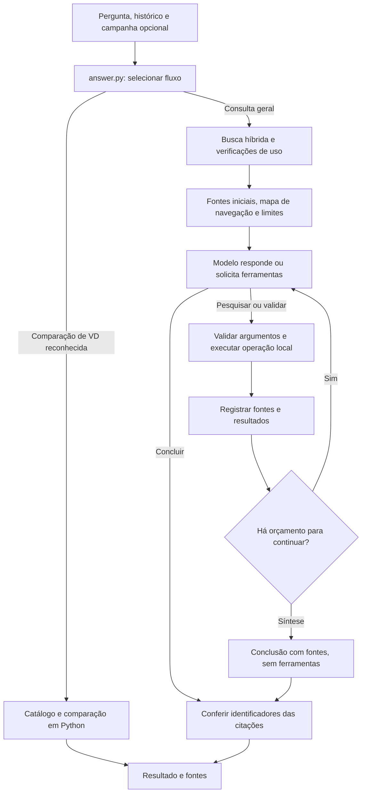

# Pesquisa no livro com ferramentas

**Escopo atual:** Ordem Paranormal RPG 1.1, um livro ativo.

**Atualização:** 21/10/2026.

Este documento descreve a implementação atual. Relatórios em `evaluation/` e documentos datados preservam resultados de versões anteriores. Ferramentas disponíveis não comprovam que o modelo encontrou todas as condições ou interpretou corretamente uma regra.

Quando fontes incluem quadros de valores iniciais das classes reconhecidas, o
perfil acrescenta fórmulas de `CLASS_RULES` com citações em `structured_rules`.
São regras implementadas em Python, separadas da transcrição do PDF, para não
confundir criação NEX 5% com ganhos por evolução. Isso não aplica atributos do
usuário nem substitui `rule_checks`, que só existe após executar o validador.
Resultados e limitações estão na [revisão final](REVISAO_FINAL.md).

## 1. Caminho de uma pergunta



1. `answer_question` recebe pergunta, modo, histórico recente e campanha opcional. Comparações reconhecidas de criaturas por maior VD usam o catálogo e cálculos em Python, sem chamada ao modelo.
2. Na consulta geral com pesquisa habilitada, a busca híbrida solicita até **três fontes iniciais**. Fontes insuficientes, chave ausente ou envio privado desativado geram resultados explícitos; fontes locais encontradas permanecem disponíveis.
3. `research_answer` registra essas fontes e monta um mapa de títulos e intervalos de páginas. **As fontes iniciais entram na primeira chamada e permanecem nas rodadas seguintes.** Não há leitura antecipada automática de catálogos nem substituição dessas fontes.
4. Havendo orçamento para pesquisar, as ferramentas usam `tool_choice="auto"`. O modelo pode responder imediatamente ou pedir uma operação. O Python valida os argumentos e executa operações de uma rodada sequencialmente.
5. Novas fontes recebem citações estáveis. As chamadas seguintes recebem os resultados, incluindo conferências parciais de ficha feitas em Python quando solicitadas.
6. A última chamada disponível sintetiza sem ferramentas. Pode haver síntese antecipada por tempo ou tamanho da requisição. Ela recebe pergunta, contexto, todas as fontes registradas e conferências de ficha, sem o histórico técnico das operações nem instruções para continuar pesquisando.
7. O backend verifica números das citações e devolve resposta, fontes, avisos, uso e resultados estruturados. Erros e limites preservam as evidências obtidas.

O agente decide dentro de uma solicitação; não executa um ciclo autônomo permanente. Conversas são persistentes, mas somente o histórico recente limitado entra no contexto do modelo. Respostas anteriores ajudam a interpretar a conversa e não valem como evidência do livro. **Missões** usa instruções criativas próprias e não executa automaticamente esse ciclo de ferramentas.

## 2. Responsabilidade dos módulos

| Módulo | Responsabilidade |
|---|---|
| [answer.py](../src/rpg_assistente/answer.py) | Prepara contexto, escolhe o fluxo, recupera fontes e verifica condições para usar a API. |
| [research.py](../src/rpg_assistente/research.py) | Controla rodadas, limites, execução das ferramentas e síntese. |
| [navigation.py](../src/rpg_assistente/navigation.py) | Monta títulos e intervalos para orientar a pesquisa. |
| [book_tools.py](../src/rpg_assistente/book_tools.py) | Valida buscas/leituras e mantém o registro de evidências canônicas. |
| [character_tools.py](../src/rpg_assistente/character_tools.py) | Oferece conferência parcial de ficha no perfil suportado, sem salvar dados. |
| [characters.py](../src/rpg_assistente/characters.py) | Implementa os cálculos e regras suportados da ficha básica. |
| [search.py](../src/rpg_assistente/search.py) | Combina busca textual/vetorial por RRF, aplica reranking e seleciona fontes. |
| [llm.py](../src/rpg_assistente/llm.py) | Integra o SDK do Groq e interpreta texto, uso, cotas e ferramentas. |
| [citations.py](../src/rpg_assistente/citations.py) | Normaliza citações numéricas e verifica seus identificadores. |
| [db.py](../src/rpg_assistente/db.py) | Persiste dados e reserva cada tentativa na cota local. |

### Mapa de navegação

`book_navigation` agrupa títulos contíguos dos metadados de páginas e compara palavras com a pergunta, normalizando acentos e algumas flexões. Não usa embeddings nem lê o texto das páginas. Retorna até **oito seções**, em **1.500 caracteres**, com posições físicas do PDF começando em 1.

O mapa não recebe citações e não constitui evidência. O modelo pode escolher ler uma lista indicada para descobrir candidatos e depois consultar suas descrições. A função auxiliar de seleção de catálogos continua no módulo, mas não é executada automaticamente por `research_answer`. Metadados incompletos podem orientar a pesquisa para um intervalo inadequado.

## 3. Ferramentas

### `search_book`

```json
{"query": "limite de pontos de esforço"}
```

Aceita somente `query`, texto de 3 a 500 caracteres. Recupera até três candidatos pela busca híbrida e relê seus textos canônicos no SQLite. Devolve prévias de até **400 caracteres**, referências e indicação de cortes.

O recorte procura termos encontrados e preserva limites de entradas de listas, favorecendo o título correspondente. Isso evita apresentar requisitos do poder anterior sem seu título junto de outro poder. Sem correspondência lexical, conserva o início do trecho recuperado semanticamente.

Prévias não comprovam conteúdo omitido. Uma fonte já registrada mantém seu texto e sua citação; buscar outro assunto no mesmo chunk pode reaproveitar a prévia anterior. A leitura de páginas amplia o contexto.

### `read_book_pages`

```json
{"pdf_pages": [31, 32]}
```

O exemplo ilustra o formato, não uma seleção obrigatória de páginas. A ferramenta aceita uma ou duas páginas físicas, com inteiros estritos entre 1 e 10.000, existentes no livro ativo. Lê `pages.text` do SQLite, sem reabrir o PDF ou executar OCR.

O limite é de **6.000 caracteres por página**, sujeito ao orçamento restante. Páginas ausentes, texto insuficiente e cortes geram avisos. Numeração física e página impressa são campos separados. Texto extraído não preserva todas as relações visuais de tabelas e caixas; o botão da fonte permite conferir a imagem original.

### `validate_basic_character`

```json
{
  "character_class": "combatente",
  "nex": 5,
  "attributes": {"forca": 3, "agilidade": 2, "vigor": 2, "presenca": 1, "intelecto": 1}
}
```

Só é oferecida quando `CharacterTools` reconhece o perfil **Ordem Paranormal 1.1**, incluindo edição, referências de páginas e blocos de regras esperados. Valida argumentos estritos e usa cálculos de `characters.py`.

**Cobertura:** distribuição dos cinco atributos e valores **base** de PV, PE, SAN, Defesa e limite de PE na criação em **NEX 5%**. Os argumentos devem refletir dados informados pelo usuário; o prompt instrui o modelo a pedir o que falta. O backend valida o formato, mas não prova sozinho que o modelo transcreveu cada valor corretamente.

**Limitações:** não valida origem, perícias, rituais, poderes, equipamento, modificadores nem evolução acima de NEX 5%. Não salva fichas ou altera campanhas. Um resultado válido certifica somente o escopo suportado para os argumentos exibidos.

Retorna erros ou valores calculados e recortes compactos das regras obtidos do SQLite canônico. Os recortes entram no mesmo orçamento de fontes e recebem citações. **`rule_checks`** apresenta separadamente argumentos, resultado da conferência e referências, permitindo conferir o cálculo sem depender apenas da prosa da LLM.

## 4. Evidências e citações

`SourceRegistry` atribui `citation_id` por inclusão e deduplica por tipo e identificador canônico. Um trecho, uma página e um recorte de regras podem aparecer separadamente, mesmo pertencendo à mesma página. Repetir uma fonte conserva conteúdo e número; novas fontes não renumeram as anteriores.

Na pesquisa, cabem até **16 fontes**, dentro do limite de texto configurado. Resultados entregues aos consumidores são cópias, e propriedades permitidas explicitamente evitam expor caminhos de arquivos.

| Campo | Significado |
|---|---|
| `citation_id` | Referência `[n]` usada na resposta. |
| `id` / `page_id` | Identificadores canônicos do trecho e, quando disponível, da página. |
| `source_kind` | `chunk`, `page` ou `catalog` para recortes estruturados, incluindo evidências da validação. |
| `pdf_page` / `printed_page` | Posição física e rótulo impresso. |
| `text` | Conteúdo efetivamente disponibilizado. |
| `original_chars` / `returned_chars` | Tamanho antes e depois dos limites aplicáveis. |
| `truncated` | Indicação de texto parcial. |

Cortes preferem palavras completas; não reconhecem automaticamente exceções essenciais. O orçamento de caracteres das evidências não equivale a tokens nem cobre todo o pedido: instruções, metadados, histórico, contexto e ferramentas também ocupam espaço.

Citações como `【7】` e `【7†】` são normalizadas para `[7]`. A verificação confirma apenas a existência do identificador. **Uma resposta com citações válidas pode conter afirmações incorretas.**

## 5. Orçamentos e encerramento

| Controle | Padrão ou comportamento |
|---|---|
| `CONSULT_TOOLS_ENABLED` | `true`; pesquisa no modo de consulta. |
| `CONSULT_MAX_MODEL_CALLS` | Até 4 chamadas; configurável de 1 a 4. Pode concluir na primeira. |
| Escolha de ferramentas | `auto` enquanto há orçamento; síntese sem ferramentas. |
| `CONSULT_MAX_TOOL_CALLS` | Até 4 operações; configurável de 1 a 6, incluindo validação de ficha. |
| `CONSULT_CONTEXT_CHARS` | 16.000 caracteres de evidências; configurável de 4.000 a 24.000. |
| Argumentos de ferramenta | Até 4.000 caracteres antes de interpretar o JSON. |
| Tempo de pesquisa | Janela de 120 segundos, verificada entre etapas. |
| Espera por reposição de tokens | Até 60 segundos por espera, deixando mais de 5 segundos na janela. |
| Timeout da chamada | Menor valor entre o configurado e o tempo restante; nenhuma chamada com no máximo 1 segundo restante. |

Antes de abrir outra rodada de ferramentas após a primeira, o backend verifica se **espera estimada pela cota + dois timeouts configurados** cabe no tempo restante. Se não couber, tenta a síntese antecipada com as fontes disponíveis. Essa reserva procura deixar tempo para concluir; não garante resposta completa nem correta.

O limite de 120 segundos não cancela instantaneamente qualquer operação local já iniciada. Espera e chamadas ao provedor consideram o prazo restante. A solicitação ainda pode terminar por timeout, cota ou outro limite, mantendo as fontes.

Cada operação processada dentro do orçamento conta, inclusive pedidos inválidos ou repetidos. Pedidos idênticos reutilizam resultados por um cache daquela solicitação, sem repetir a busca ou o cálculo. Esse cache é distinto do histórico persistente.

Com `CONSULT_MAX_MODEL_CALLS=1`, a única chamada recebe fontes e contexto sem novas operações. Com `CONSULT_TOOLS_ENABLED=false`, usa geração direta.

## 6. API, tokens e tempos

Uma pergunta pode consumir **uma a quatro chamadas ao modelo**. Cada tentativa reserva uso numa transação SQLite, verifica a cota local e libera a transação antes da rede. Falhas e reservas de processos interrompidos contam. A cota local usa UTC e não substitui os limites da conta Groq.

Cabeçalhos do Groq podem informar limite, saldo e prazo de reposição de tokens. Dados ausentes permanecem desconhecidos. O tamanho da próxima requisição é estimado por:

```text
arredondar para cima(bytes do JSON de mensagens e ferramentas em UTF-8 / 3)
+ máximo configurado de tokens de saída
```

Essa aproximação não usa o tokenizer do modelo nem mede cobrança. Se o pedido exceder o limite total informado, o fluxo tenta sintetizar sem o histórico técnico de ferramentas, preservando fontes e validações. Se ainda não couber, encerra antes de outra chamada; esperar não reduz o tamanho do pedido.

Se couber no limite total, mas exceder o saldo, pode haver espera pela reposição dentro dos limites de tempo. Isso não é retry automático após erro. Um 429 continua possível por diferenças da estimativa, outras restrições ou uso da conta por outro cliente.

| Campo retornado | Interpretação |
|---|---|
| `usage.call_count` | Tentativas contabilizadas. |
| `usage.input_tokens` / `output_tokens` | Soma das contagens quando disponíveis em todas as chamadas. |
| `usage.estimated_usd` | Estimativa com preços configurados; dados ausentes permanecem desconhecidos. |
| `usage.elapsed_ms` | Tempo nas chamadas ao modelo. |
| `usage.total_ms` | Tempo total observado no backend. |
| `usage.rate_wait_ms` | Espera pela reposição da cota. |
| `retrieval.elapsed_ms` | Recuperação inicial e execução das ferramentas locais. |
| `research.model_calls` / `tool_calls` | Quantidades de chamadas e operações. |
| `research.steps` | Ferramentas permitidas e estados resumidos. |
| `rule_checks` | Conferências parciais feitas em Python, quando executadas. |

Tempos e operações não são raciocínio interno. Mais esforço de raciocínio pode elevar tokens e latência sem garantir melhor interpretação. Histórico e instruções reenviados consomem tokens, mesmo sem fontes duplicadas no registro.

## 7. Dados enviados e fronteiras

Quando a geração é permitida, o Groq recebe pergunta, instruções, ferramentas disponíveis, fontes selecionadas, mapa e histórico das rodadas. Pode também receber histórico recente da conversa, contexto da campanha e argumentos/resultados das conferências de ficha. **As fontes iniciais entram na primeira chamada.** O PDF completo permanece local.

O despacho aceita apenas `search_book`, `read_book_pages` e, quando o perfil é reconhecido, `validate_basic_character`. Não permite shell, internet, arquivos arbitrários, credenciais ou alteração de fichas/campanhas. Argumentos são validados por Pydantic em modo estrito, sem campos extras.

Uma troca do livro detectada durante a consulta impede misturar referências. Livro, histórico e campanha são dados não confiáveis para o modelo. Instruções para tratá-los como dados ajudam, mas não provam imunidade a prompt injection. A restrição efetiva das operações fica no Python.

## 8. Resultados e limitações

Estados como `api_error`, `incomplete_response`, `daily_limit` e `research_limit` explicam encerramentos sem conclusão normal. `answered` indica texto com citações numericamente existentes; `needs_review` sinaliza citações ausentes ou inválidas. Nenhum estado certifica fidelidade factual.

Testes automatizados verificam contratos, limites, identidade de fontes, chamadas simuladas e cálculos suportados. Perguntas reais precisam de comparação da resposta e suas condições com o livro. Contagens e resultados datados ficam nos relatórios correspondentes; sucesso em testes de software não garante qualidade de toda resposta da API.

Permanecem limites concretos:

- A LLM pode pesquisar insuficientemente, misturar regras de classes ou interpretar fontes incorretamente.
- Busca e reranking selecionam candidatos; não comprovam cobertura completa do livro.
- Prévias e limites de contexto podem omitir condições ou continuações.
- A extração não preserva todas as relações visuais de tabelas e caixas.
- A validação em Python cobre apenas regras implementadas e depende dos argumentos recebidos.
- Missões não têm balanceamento automático nem alteram fatos confirmados da campanha.
- Cotas e disponibilidade do provedor afetam conclusão e latência.
- Há histórico persistente com contexto limitado, um único livro ativo e suporte validado apenas ao sistema/edição escolhidos.

A arquitetura combina recuperação, leitura dirigida e cálculos verificáveis onde existem regras implementadas. A conferência das fontes continua necessária para conclusões fora desse escopo.
