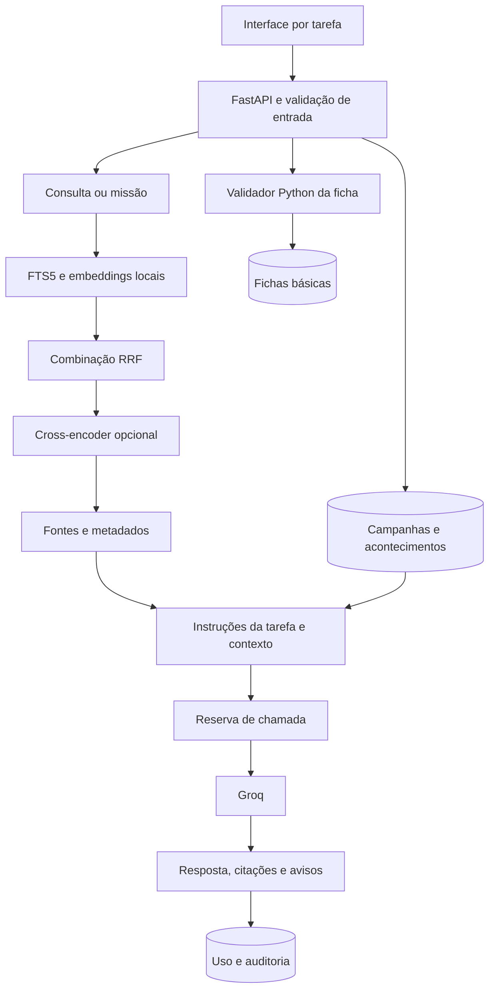

# Revisão técnica · versão 0.2

> **Registro histórico da base da versão 0.2.** A consulta ganhou posteriormente ferramentas de busca e leitura de páginas. Consulte [Pesquisa no livro](PESQUISA_NO_LIVRO.md) para o fluxo atual e o [relatório dessa evolução](../evaluation/results-research-2026-10-20.md) para sua avaliação. Os resultados e decisões desta revisão preservam a etapa em que foram registrados.

**Data:** 20/10/2026. **Escopo:** aplicativo pessoal, local, para Ordem Paranormal RPG 1.1.

Este documento complementa o [dossiê inicial](DOSSIE_TECNICO.md), que descreve a versão de 16/10. As mudanças foram motivadas pela revisão do código e por exemplos do livro; não há respostas prontas para perguntas específicas.

## 1. Direção do produto

O assistente passa a oferecer quatro espaços:

1. **Consulta:** recuperar evidência e explicar o livro.
2. **Missões:** propor uma narrativa baseada no pedido e no contexto confirmado de uma campanha.
3. **Fichas:** criar, revisar e guardar os campos básicos suportados.
4. **Campanha:** manter resumo, regras da mesa e acontecimentos.

Capturas da interface conferida: [desktop](images/interface-v2-desktop.png) e [celular](images/interface-v2-mobile.png). As capturas mostram somente a interface e os metadados do livro, sem reproduzir páginas.

Nesta etapa, a escolha da tarefa é explícita na interface. O backend executa um fluxo controlado para cada tarefa. Não foi acrescentado um ciclo autônomo de agente que decide chamar ferramentas indefinidamente: os requisitos atuais são atendidos por operações com limites e resultados verificáveis. Isso permite estudar RAG, ferramentas determinísticas e memória estruturada sem acrescentar um framework de orquestração sem necessidade.

O mecanismo de consulta continua reutilizável. O módulo de regras é específico de Ordem 1.1. Importar um PDF diferente não gera automaticamente um validador para suas regras.

## 2. Problemas encontrados e correções

| Evidência | Mudança | Limite que permanece |
|---|---|---|
| Trechos começavam no meio de palavras | Divisão respeita fronteiras e sobreposição entre palavras | Layouts e tabelas ainda usam extração textual |
| Páginas de arte/mapa viravam números isolados | Trechos sem letras não entram na busca | Não há interpretação multimodal de imagens |
| O encoder efetivo limita entrada a 128 tokens | Indexação gera janelas que cabem no limite, descontando tokens especiais | Perguntas extensas e diferentes encoders exigem nova avaliação |
| Siglas de duas letras eram eliminadas | Normalização preserva termos como PE/PV/DT | Normalização não corrige toda grafia |
| AND com poucos resultados não era complementado | OR amplia o conjunto de candidatos | Mais candidatos podem incluir ruído |
| Uma fonte por página descartava contexto útil | Até dois trechos complementares por página | Seleção ainda tem orçamento de cinco fontes |
| RRF não reconsiderava o conteúdo dos pares | Cross-encoder local opcional reordena candidatos | Não encontra evidências ausentes dos candidatos |
| Reconstrução removia índice saudável antes de terminar | Coleção nova e publicação somente após conferência | Coleções antigas ficam para manutenção |
| Duas requisições podiam ultrapassar a cota | Reserva atômica em SQLite antes da rede | Reservas interrompidas contam para a cota |
| Página podia ser renderizada de outro conteúdo após mudança do PDF | Hash do arquivo conferido antes de renderizar | Cache é invalidado por tamanho/data do arquivo |
| Um único prompt servia apenas à consulta | Instruções próprias para consulta e missão | Revisão humana continua necessária |

### Truncamento: o detalhe mais relevante

O tamanho da janela da LLM geradora não define o tamanho aceito pelo modelo de embeddings. O artefato ONNX instalado tinha configuração efetiva de **128 tokens**, dos quais dois são especiais.

Na auditoria do índice anterior, **904 dos 1.035 trechos que continham letras** ultrapassavam os 126 tokens úteis. Isso indica truncamento potencial da representação original, não prova de erro em todas essas buscas.

Agora `LocalEmbeddings.passages()` lê a configuração efetiva do tokenizer, produz janelas com sobreposição e confere novamente cada janela isolada. As janelas recebem o ID do mesmo chunk original. A busca deduplica esse ID e recupera o texto canônico no SQLite; a referência de página é preservada.

O novo índice do livro contém **330 páginas, 1.035 chunks e 2.535 vetores**. Chunks e vetores não precisam ter a mesma contagem. O SQLite anterior foi preservado em `data/backups/revision-2026-10-20/`; a coleção vetorial anterior também foi mantida.

## 3. Arquitetura atual



SQLite + Chroma continuam adequados ao uso pessoal. PostgreSQL/pgvector passa a valer o custo de operação quando houver requisitos de usuários concorrentes, implantação compartilhada ou consolidação dos bancos. LangChain continua concentrado no contrato de embeddings e no armazenamento vetorial. Não é necessário usar todas as abstrações da biblioteca para demonstrar seu uso.

### Novos módulos e responsabilidades

| Arquivo | Responsabilidade |
|---|---|
| [rerank.py](../src/rpg_assistente/rerank.py) | Preparar e executar o cross-encoder local; cache e falha controlada |
| [characters.py](../src/rpg_assistente/characters.py) | Tipos, opções de criação, validação e cálculos base de Ordem 1.1 |
| [campaigns.py](../src/rpg_assistente/campaigns.py) | Contratos da campanha e seleção limitada do contexto |
| [security.py](../src/rpg_assistente/security.py) | Origem das escritas, corpo JSON limitado e cabeçalhos |
| [api.py](../src/rpg_assistente/api.py) | Rotas, persistência de fichas/campanhas, fontes e apresentação |
| [answer.py](../src/rpg_assistente/answer.py) | Tarefa, fontes, prompt, reserva de cota, geração e auditoria |
| [app.js](../src/rpg_assistente/static/app.js) | Formulários, estados, navegação e renderização segura |
| [style.css](../src/rpg_assistente/static/style.css) | Layout responsivo, foco e hierarquia visual |

`search.retrieve()` retorna fontes **e diagnóstico**. O wrapper `hybrid_search()` permanece para compatibilidade da CLI e da avaliação. Uma falha nos vetores ou no reranker aparece como aviso; o usuário consegue perceber quando houve degradação.

## 4. Reranking local

Modelo preparado: `BAAI/bge-reranker-v2-m3-int8`, usando FastEmbed/ONNX em CPU. A [documentação do FastEmbed](https://qdrant.tech/documentation/fastembed/fastembed-rerankers/) descreve a interface de reranking utilizada.

Um bi-encoder permite pré-calcular documentos; o cross-encoder avalia pergunta e trecho juntos. O segundo é mais caro por candidato, portanto é aplicado depois da recuperação inicial. Ele reordena evidências; não calcula a probabilidade de uma resposta estar correta.

Preparação:

```powershell
.\.venv\Scripts\rpg-assistente.exe prepare-reranker
```

Ativação no `.env`:

```dotenv
RERANK_ENABLED=true
RERANK_CANDIDATES=10
```

Os pedidos interativos só carregam arquivos locais já preparados. A ausência do modelo produz um aviso e preserva a busca híbrida. A pontuação não é um corte automático de “verdade”.

## 5. Ficha básica: contrato honesto

O validador cobre **criação em NEX 5%**:

- Cinco atributos inteiros, de 0 a 3.
- Soma 9 e no máximo um atributo reduzido a zero.
- Classes Combatente, Especialista e Ocultista.
- PV, PE, SAN, Defesa e limite de PE **base**.

As referências foram conferidas nas páginas 22, 31, 33, 37, 41 e 44 do PDF (impressas 14, 23, 25, 29, 33 e 36). As páginas das características das classes também foram conferidas visualmente.

O relatório inclui `valid`, `errors`, `warnings`, `derived`, `sources` e `scope`. **`valid=true` só aprova esse recorte.** `scope.full_sheet_validated` permanece falso. Benefícios de origem podem alterar números; origem e notas são guardadas como texto e não modificam cálculos. A interface chama os resultados de valores base.

Fichas com erro no recorte não são salvas. Campos adicionais desconhecidos, booleanos e números fracionários nos atributos são rejeitados. O retorno não inclui automaticamente o conteúdo completo recebido nos erros de validação.

Ainda faltam perícias, habilidades, rituais, equipamento, modificadores de origem, evolução e leitura automática de fichas externas. Um NPC pode ser registrado como personagem básico com anotações, mas a geração automática de uma ficha completa de NPC permanece futura.

## 6. Campanhas e missões

As tabelas `campaigns`, `campaign_events` e `characters` são independentes das tabelas do livro. Reimportar material não apaga esses registros.

O contexto inclui resumo, regras da mesa e últimos 12 eventos, respeitando um orçamento de 6 mil caracteres para eventos. O histórico completo continua persistido. Quando há omissão, um aviso orienta a atualizar o resumo.

Na missão, a LLM pode criar conflitos e pistas. Ela precisa separar fatos confirmados, regras citadas e criação. Sem dados suficientes do grupo, deve declarar limitações de balanceamento. A geração não insere eventos: o mestre decide o que aconteceu e registra isso separadamente.

Essas instruções são objetivos do prompt, não garantias. Os testes reais revelaram extrapolações de regras e de fatos da campanha. A interface identifica a missão como proposta a revisar. O renderizador suporta listas, ênfase e tabelas simples com rolagem interna, porque a LLM pode ignorar a preferência por texto sem tabelas; HTML arbitrário permanece texto.

Selecionar uma campanha autoriza incluí-la naquela chamada ao provedor configurado. A interface explica esse envio. Não há histórico automático de chat nem memória implícita de todas as consultas.

## 7. Segurança e operação

- Apenas hosts locais são aceitos. O serviço deve permanecer vinculado a `127.0.0.1`.
- Escritas de origens diferentes são bloqueadas; corpos devem ser JSON e ter até 32 KiB.
- A interface usa arquivos locais, sem bibliotecas CDN. Conteúdo gerado é inserido com nós de texto, sem interpretar HTML arbitrário.
- Política de conteúdo, proteção contra incorporação em frames e `nosniff` complementam a defesa. A documentação Swagger mantém seus próprios scripts.
- Rotas retornam erros genéricos para exceções inesperadas; logs registram o tipo, sem copiar chave ou corpo do provedor.
- A reserva da cota usa `BEGIN IMMEDIATE`; a rede é chamada após liberar a transação.
- A auditoria registra modo, IDs das fontes, hash do livro, versão do prompt e tempos. Não registra automaticamente perguntas e respostas completas.
- Referências inexistentes geram aviso nos dois modos. Ausência de citação gera aviso no modo de consulta; uma missão puramente criativa pode não citar regras. Existência de citação não comprova suporte factual.
- A imagem da fonte exige que o PDF ainda corresponda ao hash importado.

Essas medidas protegem o cenário pessoal. Não há autenticação, autorização por usuário, segregação de campanhas entre contas ou configuração de implantação pública.

## 8. Testes e avaliação

A suíte passou com **86 testes** durante a integração. São testes locais com dados sintéticos e transporte/modelos simulados quando necessário, sem consumo de API.

Cobrem extração e referências, janelas por tokens, reindexação com falha, fallback de recuperação, Groq e seus erros, validação das três classes, fichas persistidas, campanhas, contexto, missão sem alteração automática do histórico, cota concorrente, origem/corpo de requisições e hash do PDF.

A avaliação em livro real e as medições de latência estão no [registro de resultados desta revisão](../evaluation/results-2026-10-20.md). Elas devem distinguir:

1. Presença da página esperada nos cinco primeiros resultados.
2. Presença do trecho que realmente sustenta a resposta.
3. Correção e completude da resposta gerada.
4. Citações e abstenção quando não há evidência.

Um teste de página não substitui os outros três. Casos acrescentados após observar uma falha devem ser identificados como calibração; precisamos de perguntas reservadas para medir generalização.

## 9. Próximas etapas

1. Ampliar casos anotados com evidência exata, respostas que dependem de várias páginas e perguntas sem resposta.
2. Melhorar extração de tabelas e associação de subseções, medindo impacto.
3. Implementar benefícios de origem e perícias com testes por regra.
4. Acrescentar rascunhos de missões e NPCs estruturados, separados dos eventos confirmados, com referências aos fatos usados. Um schema ajuda no formato e na rastreabilidade; coerência factual ainda precisa de avaliação.
5. Só então generalizar importação para outros livros: catálogo/edição, avaliações por documento e módulos de regras por sistema.

A arquitetura foi mantida proporcional: uma aplicação FastAPI, serviços Python pequenos, dois armazenamentos locais e uma integração de geração. Cada camada tem uma responsabilidade que pode ser explicada e testada.
